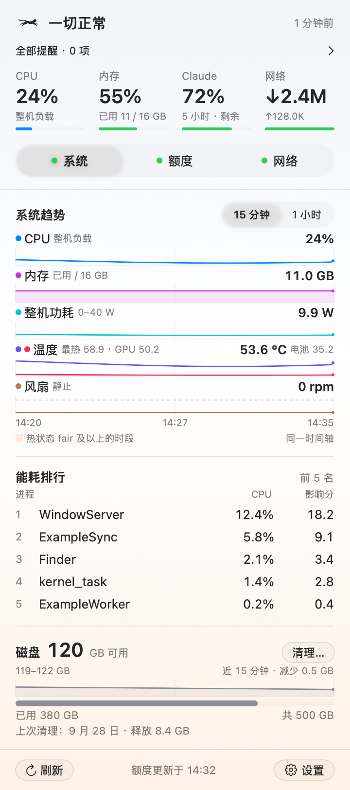
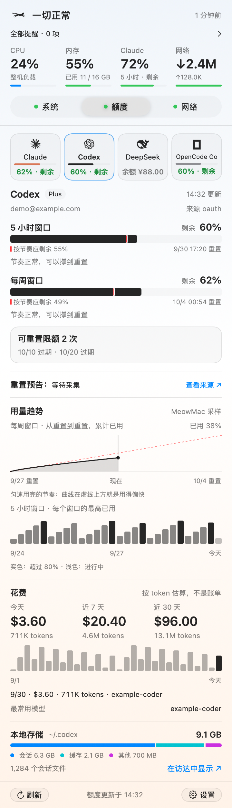
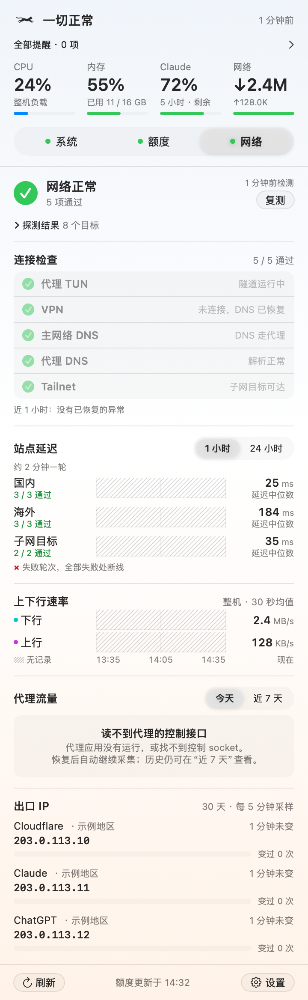

# MeowMac

MeowMac 是一个 macOS 菜单栏应用，用猫的速度和形态显示整机负载与健康状态，并汇总系统、AI 额度和网络状态。

适合想随时了解 Mac 负载、AI 额度余量，以及代理网络是否正常的人。点一下菜单栏里的猫，就能看到三个面板。

## 主要功能

- **菜单栏里的猫**：负载越高跑得越快；系统、额度或网络出现问题时改变形态。提醒集中展示，可调整规则和阈值。
- **系统状态**：CPU、内存、整机功耗、温度和风扇的同轴趋势；能耗进程排行、磁盘余量和清理记录。传感器可用性随硬件而异。
- **AI 额度**：汇总 Claude、Codex、DeepSeek 和 OpenCode Go，展示额度窗口或余额、重置时间、使用节奏、历史趋势、估算花费和本地会话存储。各渠道展示内容取决于数据源。
- **网络检测**：检查代理 TUN、VPN、DNS 和可选的 Tailnet 目标；查看站点延迟、整机上下行速率、代理流量汇总，以及出口 IP 的变化记录。
- **按需配置**：在应用内调整检测站点、网络参数、额度源、提醒、外观和面板布局；可把系统诊断材料预览后交给本机已有的 Agent。

## 界面预览

下图由当前界面代码使用虚构数据渲染，账号为示例账号，IP 使用文档保留地址，不含实机采集数据。预览使用替代背景，实际材质随 macOS 版本和外观变化。

| 系统 | AI 额度 | 网络 |
| --- | --- | --- |
|  |  |  |

## 下载安装

运行需要 **macOS 14 或更新版本**。预编译包目前仅提供 **Apple Silicon（arm64）** 版本。

从 [Releases](https://github.com/eastcn/meowmac/releases) 下载 ZIP，解压后将 `MeowMac.app` 放入“应用程序”或 `~/Applications/`，打开后从菜单栏的猫进入面板。

当前发布包使用 ad-hoc 签名，未经 Apple 公证。首次打开可能被 Gatekeeper 拦截；核对下载来源后，可在系统设置的“隐私与安全性”中按 macOS 提示允许打开。

**安装包已内嵌 TunCanary 网络检测库，不需要单独下载、安装或运行 TunCanary，也不需要克隆源码。** CodexBar 和 Mole 是可选外部工具，缺少它们不影响系统和网络面板启动；相应的额度或清理功能不可用。

## 网络配置

首次安装没有旧配置时，直接加载默认值：

- 站点为百度、哔哩哔哩、Google、GitHub 和 Cloudflare；本机检查每 20 秒一次，轻量站点探测每 2 分钟一次。
- 出口 IP 默认通过 Cloudflare 检测，每 5 分钟一次；未设置地域限制时只记录变化。
- 默认读取 Clash Verge Rev 的配置来识别 TUN 和代理 DNS。没有安装该客户端时，会提示证据不足；它不会替你安装代理或修改系统网络设置。
- 内网地址、Tailnet 目标和 VPN 适配器默认未配置；需要时再添加。

在“设置 → 网络”里可以修改站点、出口 IP、代理与 DNS、检测频率。使用其他代理客户端时选择“手动”，按实际配置填写 fake-ip 网段及可选的 DNS 端口、核心进程名。检测结论取决于能取得的证据，并不保证兼容所有客户端。

MeowMac 与独立 TunCanary **共用网络设置**（`io.github.eastcn.tuncanary` 偏好域），已有设置会直接沿用；在任一应用里保存都会影响另一应用。网络检测历史保存在 MeowMac 自己的数据目录中。

当前 Claude、Codex 额度查询有额外的代理保护：只有确认 Clash Verge Rev 核心和 TUN 正常时才发起查询。手动代理模式或状态不明时会暂停这两个渠道的查询，并显示已有缓存；这与普通站点检测是否可用是两回事。

## 从源码构建

构建需要带 macOS 26 SDK 的 Command Line Tools；SwiftPM 的 tools-version 保持 5.10。

仅源码构建需要 [TunCanary](https://github.com/eastcn/tuncanary)，以本地路径 `../tuncanary` 引用。将两个仓库放在同一目录下，TunCanary 使用已验证的 `v0.5.2`：

```sh
git clone https://github.com/eastcn/meowmac.git
git clone --branch v0.5.2 https://github.com/eastcn/tuncanary.git
cd meowmac
scripts/check.sh
scripts/build-app.sh
scripts/install.sh
```

应用安装到 `~/Applications/MeowMac.app`。安装脚本会请求正在运行的 MeowMac 正常退出，再安装并在后台启动。

## 本地开发签名

默认用 ad-hoc 签名，任何人克隆后都能构建。ad-hoc 签名的系统授权（文稿、通知等）绑定代码哈希，代码一变就失效，每次安装新版本都会重新弹窗。

本地反复开发时，可以创建一张只存在于本机的自签名证书：

```sh
scripts/setup-local-signing.sh
```

脚本会往登录钥匙串导入证书，并把它设为当前用户的代码签名可信，过程中系统会弹出授权框。创建后，`scripts/build-app.sh` 会自动使用它，授权跨版本保留。首次换签名后需要重新点一次系统授权。

- 证书名默认是 `MeowMac Local Development`，可用 `MEOWMAC_LOCAL_IDENTITY_NAME` 改。
- 用 `MEOWMAC_SIGN_IDENTITY` 指定其他钥匙串身份，设为 `-` 则强制 ad-hoc。
- 这张证书只用于本机开发，不对外分发，私钥不要提交到仓库。别人下载的构建不会被系统信任。

## 开发验证

`scripts/test.sh` 和 `scripts/check.sh` 默认在后台运行。纯逻辑、存储、协调器和后台渲染照常验证；会显示窗口、弹出面板或唤起终端的用例输出 `SKIP`，不计为通过。过滤词、实机开关和预览目录都不会自动开启前台验收。

需要操作原生窗口或核对真实材质时，选择不影响前台使用的时机，显式开启：

```sh
scripts/test.sh --list                         # 标出需要前台的用例
MEOWMAC_UI_TESTS=1 scripts/test.sh UI.Reset     # 可见原生容器验收
MEOWMAC_UI_TESTS=1 scripts/check.sh             # 完整离线验收，包含可见 UI
```

完整离线验收仍是交付检查的一部分。后台检查通过时，应同时记录未执行的前台用例。安装脚本使用后台启动，不自动展示验证窗口。

## 数据来源

- 系统状态来自 macOS 公开接口。清理记录来自 Mole 的 `mo history --json`。
- AI 额度来自 CodexBarCLI。需要安装 CodexBar；MeowMac 不启动 CodexBar.app。
- 网络检测通过内嵌的 TunCanary 库运行，相邻源码目录只用于编译。

## 许可

本项目使用 [MIT 许可](LICENSE)。

渠道 logo 来自 CodexBar 的 ProviderIcon SVG 资源（MIT 许可），分别是 Anthropic、OpenAI、DeepSeek 和 OpenCode 的商标。商标权归各自所有者。详见 [第三方声明](THIRD_PARTY_NOTICES.md)。
